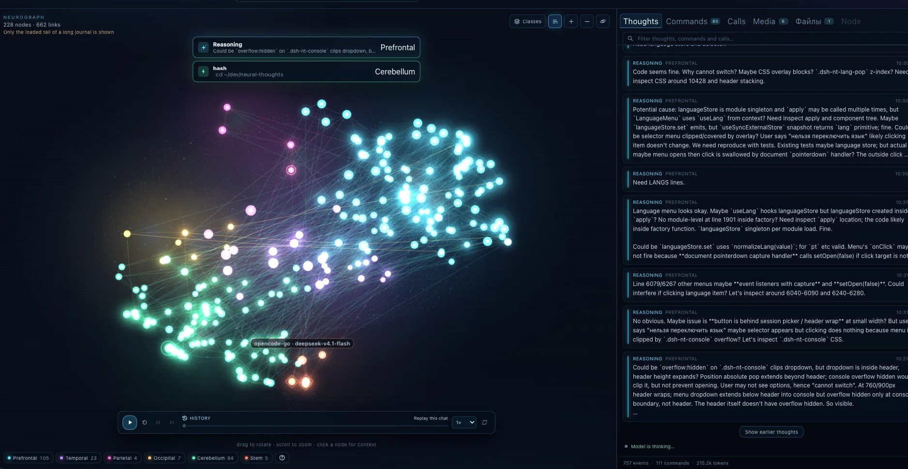

# Neural mind

**A read-only 3D neural map for DeepSeek Harness chats and projects.**

[Русский](README.ru.md) · [Security](SECURITY.md) · [Changelog](CHANGELOG.md) · [MIT License](LICENSE)



Neural mind turns the Session journal of a DeepSeek Harness chat into a living
brain-shaped graph. Reasoning, tool calls, documents, references, plans, the
model route, and the task context each get a place in the brain. You can watch a
request unfold, inspect any node, compare chats in a project, and browse every
screenshot or render the chat produced.

It is an observer: it sends nothing, creates no model requests, and adds no
Host services. Everything is read through the existing Client Session Controller
and the authenticated attachment/file routes of the running DSH Web UI.

## Features

- **Chat mode** — pick any chat; the brain rebuilds from its Session journal.
  Chats where the model is working are marked and sorted first.
- **Project mode** — pick a workspace (or a folder group / “No project”) and see
  its chats as connected nodes, with fork, subagent, and time links. Drill into
  any chat to open its brain; double-click a chat node in the project graph.
- **Prompts as their own class** — your messages are diamond-outlined nodes in the
  brainstem. Use the **Classes** lens to isolate prompts, thoughts, actions,
  documents, plans, or context without changing the brain lobes. The **My
  prompts** anchor under Thoughts opens the latest one. Diamonds stay quiet on
  the overall map until hovered, selected, or class-filtered.
- **Live thoughts and event cards** — reasoning streams in a banner above the
  brain. Committed thoughts, answers, tool calls, documents, references, plans,
  goals, agent events, failures, and media arrivals pop up as clickable cards
  tagged with their sector.
- **Inspectable graph** — hover a node for type, sector, status, and an excerpt;
  click it for arguments, result, media, and separate incoming/outgoing links.
  The selected node gets a strong outline while unrelated nodes dim.
- **Sector guide** — hover a sector chip for its meaning, or open the `?` guide
  for the whole map.
- **Media gallery** — screenshots, renders, and clips collected as thumbnails.
  Open a full preview, jump to its source node, download it, or page older
  history with **Show earlier files**. Newly created or accessed media also pops
  above the brain with a real thumbnail.
- **Files tab** — Markdown, CSV/TSV, JSON/YAML, code, logs and other text files
  from the session workspace. Markdown gets a safe HTML-free preview; CSV/TSV
  gets a table; everything else is shown as text. Copy, download, jump to the
  source node, or page older history. Newly created or accessed text files pop
  above the brain with a file card.
- **Calls tab** — skill and MCP calls in one place, grouped by family with
  **All / Skills / MCP** filters, status, timing, and click-to-open. On the brain,
  a skill gets a hexagon glyph and an MCP server call gets a port glyph, with
  family labels, live call counters, hover details and clickable call cards.
- **Languages** — Russian, English, German, French, Spanish, Italian, Portuguese.
  English is the default on first run; the choice is remembered after that.
- **History timeline** — replay how the brain was built. Play/pause, restart,
  step back/forward, scrub the timeline, choose **0.5× / 1× / 2× / 4×**, loop,
  and return to live. Milestone dots mark prompts, thoughts, tools, answers and
  documents and jump to that event. During playback the live banners and cards
  are hidden so the historical graph is clear.
- **Controls** — labels toggle, fullscreen, chat filter, project search, node
  copy, keyboard rotation/zoom/selection, and a reduced-motion-aware renderer.
  Drag the **left edge of the side panel** to resize it; the width is remembered.
  Node, media and text inspectors open as full-panel modals above the whole
  Neural mind surface.

## Requirements

- DeepSeek Harness **0.2.2-rc.3 or newer** (Desktop or Web UI).
- The standard Client conversation UI
  (`@deepseek-ai/dsh-client-ui-conversation`), which owns the authorized image
  cache used by the media gallery.
- No build step and no runtime dependencies beyond what DSH already ships.

## Install from this folder

1. Keep the folder somewhere stable, for example
   `~/Documents/deepseek-harness/default-workspace/neural-thoughts`.
2. In DSH open **Plugins → Add plugin / Install bundle** and choose this folder.
3. Enable the **Neural mind** bundle if it is not enabled, then refresh the Web UI.
4. Open any chat and use the **Neural mind** pill under the composer.

The bundle is marked `"private": true`; it is meant for local/GitHub
installation, not an npm release. Installing the same directory into another DSH
profile is enough — the Host half has no services to configure.

### Install directly from Git

When the repository is available on GitHub, DSH can install it directly. In
**Plugins → Add plugin**, paste the repository address:

```text
https://github.com/askerrag/dsh-neural-thoughts
```

DSH reads the bundle from the repository root (`package.json` with
`dsh.bundle.patch` and `dsh.client`), installs it through pnpm, and enables the
row. No build step runs. A Git install can be updated from the Plugins page when
the repository gets a newer commit.

### Install from a tarball

`npm pack` produces a standard package tarball with the bundle at its `package/`
root. Upload it as a GitHub release asset and paste the asset URL into
**Plugins → Add plugin**, or use the local path to the `.tgz` file.

```sh
npm pack
# local-neural-thoughts-1.6.1.tgz
```

The release tarball is optional: cloning the repository and choosing the folder
works the same way.

### Manual install for development

The DSH Plugin Manager is the supported path. For development, a symlink in the
profile works the same way as any other local bundle; do not edit the profile by
hand unless you know the profile composition. The bundle's `dsh.bundle.patch`
inserts the `neural-thoughts` row and `dsh.client.platform: "web"` loads
`client.js` into the Web UI.

## Use

- Open the pill under the composer. The panel remembers the last chat/project.
- **Chat:** choose a chat in the header selector. The header shows how much of a
  long journal is loaded; older graph nodes are folded away at the node cap.
- **Project:** switch to **Project** and choose a workspace. The side panel lists
  chats and links; open one to return to Chat mode with that chat's brain.
- **Classes:** the layers icon in the graph's top-right corner. Counts and short
  descriptions explain each class.
- **Media:** the **Media** tab in the side panel. If the loaded journal does not
  reach the files you need, use **Show earlier files**.
- **Keyboard on the canvas:** arrow keys rotate, `+`/`-` zoom, `[`/`]` (physical
  bracket keys on any layout) or `PageUp`/`PageDown` cycle nodes, `Enter` opens
  the selected node, `Esc` closes the panel.

## Privacy and security

- The panel is a **client-side observer**. It makes no outbound network requests,
  sends no telemetry, and adds no model requests.
- Session data is read through the existing `ctx.sessions` Client Session
  Controller. Durable images are read through the authorized
  `uiConversation.imageUrl(sessionId, attachment)` cache; local deliverable
  images/videos use DSH's authenticated `/api/file` route. There are no hardcoded
  hosts, absolute user paths, credentials, or API keys in the bundle.
- It can see any Session the user can select in DSH, exactly because it uses the
  same Session Controller and attachment authorization as the main UI.
- Media is displayed as ``/`<video>`; filenames and journal text are rendered
  as text by React, not injected as HTML. The file route is same-origin and
  authenticated; no remote image URLs from tool content are fetched.
- **Show earlier files** pages older Session history into the loaded window, which
  is how the galleries reach files outside the initial tail. It does not modify
  history.
- Skill and MCP calls are **displayed from the existing Session journal only**.
  The plugin never invokes a skill, connects to an MCP server, or reads MCP
  credentials; it classifies the `skill` and `mcp__…` tool names locally for the
  Calls tab and the brain. No call arguments or results are sent anywhere.
- The Files tab only lists text files **inside the selected Session workspace**,
  never arbitrary system paths. Secret-like names and directories (`.env`, keys,
  credentials, tokens, `.ssh`, `.aws`, `.dsh`, `.git`, `node_modules`, …) are
  excluded. File content is fetched only when you open a file, through the
  authenticated same-origin file route, capped at 512 KiB. Markdown is rendered
  to React elements without raw HTML or remote images; links are limited to
  `http(s)`; CSV/TSV is parsed as text tables with row/column caps. No file content
  is uploaded or sent to a model.
- The bundle declares `"private": true` to prevent an accidental npm publish.

See [SECURITY.md](SECURITY.md) for the full security model and reporting.

## Limits

- Only the loaded part of a long journal is shown. The header reports truncation;
  the task anchor falls back to the durable session title and marks that node as
  title-derived.
- The graph keeps at most 320 nodes. The media gallery keeps the newest 160
  files and the newest 240 creation/access occurrences.
- A project shows up to 90 chats on the graph and 200 in its list. The rest stay
  reachable by opening a chat directly or narrowing the project.
- The media gallery cannot show every arbitrary file: images carried as durable
  attachments and images/videos from `present` deliverables are supported. Plain
  text paths without an attachment or deliverable record are not collected.
  Local video playback is bounded by the byte limit of DSH's `/api/file` route.
- The Files tab keeps the newest 120 text files and 240 creation/access
  occurrences. It collects paths from `read`/`write`/`edit`/`apply_patch` tool
  calls and `present` deliverables under the workspace, not arbitrary shell
  output. Files larger than 512 KiB are listed but not previewed. Binary and
  secret-like files are intentionally excluded.
- The Calls tab keeps the newest 120 skill/MCP call nodes from the loaded graph;
  counters cover the loaded graph, not the entire on-disk journal. Project mode
  does not aggregate calls across chats; open a chat to its own Calls tab.
- Project mode does not aggregate media across all project chats; open a chat to
  browse its own gallery.
- The panel is a dark observer surface; the composer pill uses DSH theme tokens.

## Project layout

```
neural-thoughts/
├── client.js            # Web UI plugin; renderer, folding, panel, media, calls
├── index.js             # Host half: intentionally no services
├── cordis.patch.yml     # Inserts the bundle row
├── package.json         # DSH bundle + client manifest
├── locale/              # Plugin display metadata (en, ru, de, fr, es, it, pt)
├── docs/                # Plugin detail pages + text-free feature preview
└── icon.svg             # Original plugin icon
```

There is no bundler, TypeScript, or generated output. `client.js` is the shipped
browser module loaded by `window.__ModuleLoader__.load({ id, factory(require) })`;
`index.js` is the no-op Host half.

## Development checks

```sh
node --check client.js
node --check index.js
node -e "for (const f of require('fs').readdirSync('locale')) JSON.parse(require('fs').readFileSync('locale/'+f,'utf8'))"
```

The plugin is read-only by design; no test fixtures or session data are included
in this repository.

## License

MIT — see [LICENSE](LICENSE). The icon and preview artwork are original and are
included under the same license.

Neural mind is a community plugin, not an official DeepSeek product.
