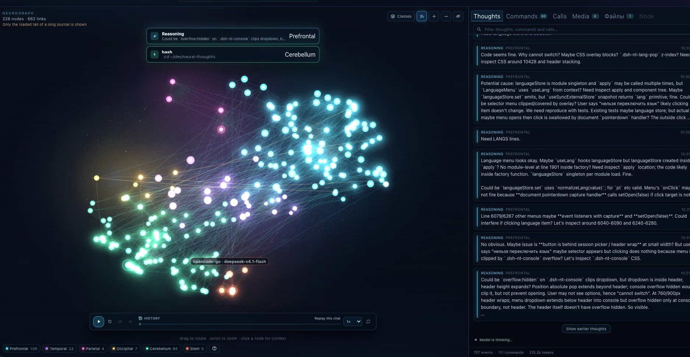

# Нейромозг

**Read-only трёхмерная карта мыслей для чатов и проектов DeepSeek Harness.**

[English](README.md) · [Безопасность](SECURITY.md) · [История изменений](CHANGELOG.md) · [MIT License](LICENSE)



Нейромозг превращает журнал сессии DeepSeek Harness в живой граф в форме мозга.
Рассуждения, вызовы инструментов, документы, референсы, планы, маршрут модели и
контекст задачи получают своё место. Можно смотреть, как разворачивается запрос,
открывать любой узел, сравнивать чаты проекта и просматривать все скриншоты и
рендеры, которые создал чат.

Это наблюдатель: он ничего не отправляет, не делает запросов к модели и не
добавляет Host-сервисов. Всё читается через существующий Client Session Controller
и авторизованные маршруты вложений/файлов работающего Web UI DSH.

## Возможности

- **Режим чата** — выберите чат; мозг пересобирается из его журнала. Чаты, где
  модель работает, помечены и отсортированы первыми.
- **Режим проекта** — выберите рабочее пространство (или группу папок / «Без
  проекта») и увидите его чаты связанными узлами: форк, подагент, время. В любой
  чат можно провалиться; в графе проекта — двойным кликом.
- **Промпты — отдельный класс** — ваши сообщения это узлы-ромбы в стволе мозга.
  Линза **«Классы»** изолирует промпты, мысли, действия, документы, планы или
  контекст, не меняя доли. Якорь **«Мои промпты»** в «Мыслях» открывает последний.
  На общей карте ромбы тихие, пока на них не навели, не выбрали или не включили
  фильтр класса.
- **Живые мысли и карточки событий** — рассуждения идут лентой над мозгом;
  завершённые мысли, ответы, команды, документы, референсы, планы, цели, события
  агентов, сбои и появление медиа всплывают кликабельными карточками с меткой доли.
- **Исследуемый граф** — наведение показывает тип, долю, статус и фрагмент; клик
  открывает аргументы, результат, медиа и отдельно входящие/исходящие связи.
  Выбранный узел получает сильный контур, остальные притухают.
- **Гид по долям** — наведите на чип доли или откройте `?` с описанием всего мозга.
- **Галерея медиа** — скриншоты, рендеры и клипы в виде превью. Полный просмотр,
  переход к узлу-источнику, скачивание и кнопка **«Показать более ранние файлы»**
  для старых записей. Новые или открытые файлы также всплывают над мозгом с
  настоящим превью.
- **Вкладка «Файлы»** — Markdown, CSV/TSV, JSON/YAML, код, логи и другие текстовые
  файлы из рабочего пространства сессии. Markdown показывается безопасным
  предпросмотром без HTML, CSV/TSV — таблицей, остальное — текстом. Копирование,
  скачивание, переход к узлу-источнику и подгрузка более ранней истории. Новые
  или открытые текстовые файлы всплывают над мозгом карточкой файла.
- **Вкладка «Вызовы»** — вызовы скиллов и MCP в одном месте, с группировкой по
  типу, фильтрами **«Все / Скиллы / MCP»**, статусом, временем и переходом к узлу.
  На мозге скилл получает шестиугольник, а вызов MCP-сервера — порт; есть подписи,
  живые счётчики, подсказки при наведении и кликабельные карточки вызовов.
- **Языки** — русский, английский, немецкий, французский, испанский, итальянский,
  португальский. По умолчанию открывается английский; выбор запоминается.
- **Таймлайн истории** — воспроизведение того, как строился мозг: play/pause,
  с начала, шаг назад/вперёд, перетаскивание таймлайна, скорость
  **0.5× / 1× / 2× / 4×**, повтор и возврат к текущему. Точки-маркеры отмечают
  промпты, мысли, инструменты, ответы и документы и переносят к событию. Во
  время воспроизведения живые баннеры и карточки скрыты, чтобы не мешать
  историческому графу.
- **Управление** — подписи, полный экран, фильтр мыслей, поиск по проекту,
  копирование узла, клавиатурное вращение/зум/выбор и уважение reduced motion.
  Потяните **левый край боковой панели**, чтобы изменить её ширину — значение
  запоминается. Карточки узла, медиа и текстовых файлов открываются модально
  поверх всей поверхности «Нейромозга».

## Требования

- DeepSeek Harness **0.2.2-rc.3 или новее** (Desktop или Web UI).
- Стандартный клиентский интерфейс диалога
  (`@deepseek-ai/dsh-client-ui-conversation`) — он владеет авторизованным кэшем
  изображений, который использует галерея.
- Сборка не нужна; дополнительных runtime-зависимостей сверх DSH нет.

## Установка из этой папки

1. Оставьте папку в стабильном месте, например
   `~/Documents/deepseek-harness/default-workspace/neural-thoughts`.
2. В DSH откройте **Plugins → Add plugin / Install bundle** и выберите эту папку.
3. Включите bundle **Neural mind**, если он выключен, и обновите Web UI.
4. Откройте чат и нажмите кнопку **«Нейромозг»** под полем ввода.

Bundle помечен `"private": true`: он предназначен для локальной/GitHub
установки, а не для публикации в npm. Для другого профиля DSH достаточно
установить ту же папку — у Host-половины нет сервисов для настройки.

### Установка напрямую из Git

Если репозиторий уже доступен на GitHub, DSH может установить его напрямую. В
**Plugins → Add plugin** вставьте адрес:

```text
https://github.com/askerrag/dsh-neural-thoughts
```

DSH читает bundle из корня репозитория (`package.json` с `dsh.bundle.patch` и
`dsh.client`), ставит его через pnpm и включает строку. Сборка не запускается.
Обновление Git-установки доступно на странице Plugins, когда в репозитории
появляется новый коммит.

### Установка из tarball

`npm pack` создаёт стандартный пакет с bundle в корне `package/`. Загрузите его
как asset GitHub release и вставьте ссылку в **Plugins → Add plugin** либо
укажите локальный путь к `.tgz`.

```sh
npm pack
# local-neural-thoughts-1.6.1.tgz
```

Tarball не обязателен: клонирование репозитория и выбор папки работают так же.

## Использование

- Откройте кнопку под композером. Панель запоминает последний чат/проект.
- **Чат:** выберите чат в селекторе шапки. Шапка показывает, загружен ли журнал
  полностью; при лимите узлов старые сворачиваются.
- **Проект:** переключитесь на **«Проект»** и выберите пространство. Боковая
  панель показывает чаты и связи; открытие чата возвращает в режим чата с его
  мозгом.
- **Классы:** иконка слоёв в правом верхнем углу графа. У классов есть счётчики
  и короткие описания.
- **Медиа:** вкладка **«Медиа»** в боковой панели. Если нужных файлов нет в
  загруженной части — **«Показать более ранние файлы»**.
- **Клавиатура на холсте:** стрелки вращают, `+`/`-` масштабируют, `[`/`]`
  (физические клавиши на любой раскладке) или `PageUp`/`PageDown` переключают
  узлы, `Enter` открывает выбранный, `Esc` закрывает панель.

## Приватность и безопасность

- Панель — **клиентский наблюдатель**. Она не делает исходящих сетевых запросов,
  не отправляет телеметрию и не создаёт запросов к модели.
- Данные сессии читаются через существующий `ctx.sessions` Client Session
  Controller. Устойчивые изображения — через авторизованный кэш
  `uiConversation.imageUrl(sessionId, attachment)`; локальные изображения/видео из
  результатов — через авторизованный `/api/file` DSH. В bundle нет жёстко
  заданных хостов, пользовательских путей, ключей или токенов.
- Панель видит те сессии, которые пользователь может выбрать в DSH, потому что
  использует тот же Session Controller и ту же авторизацию вложений, что и
  основной интерфейс.
- Медиа показывается через ``/`<video>`; имена файлов и текст журнала
  рендерятся React как текст, а не как HTML. Файловый маршрут same-origin и
  авторизован; внешние URL из содержимого инструментов не загружаются.
- **«Показать более ранние файлы»** подгружает более старую историю сессии в
  загруженное окно — так галереи добираются до файлов вне начального хвоста.
  Историю это не изменяет.
- Вызовы скиллов и MCP только **отображаются по журналу сессии**. Плагин не
  запускает скиллы, не подключается к MCP-серверам и не читает MCP-учётные
  данные; имена инструментов `skill` и `mcp__…` классифицируются локально для
  вкладки «Вызовы» и мозга. Аргументы и результаты вызовов никуда не отправляются.
- Вкладка «Файлы» показывает только текстовые файлы **внутри рабочего
  пространства выбранной сессии**, а не произвольные системные пути. Файлы и
  каталоги с секретными именами (`.env`, ключи, credentials, tokens, `.ssh`,
  `.aws`, `.dsh`, `.git`, `node_modules` и т.п.) исключены. Содержимое
  загружается только при открытии файла, через авторизованный same-origin
  маршрут, с лимитом 512 КиБ. Markdown рендерится в React-элементы без сырого HTML
  и удалённых картинок; ссылки только `http(s)`; CSV/TSV разбирается в текстовую
  таблицу с лимитами строк/колонок. Содержимое файлов никуда не отправляется и не
  передаётся модели.
- Bundle объявлен `"private": true`, чтобы исключить случайную публикацию в npm.

Полная модель безопасности и порядок сообщения об уязвимостях — в
[SECURITY.md](SECURITY.md).

## Ограничения

- Видна только загруженная часть длинного журнала. Шапка сообщает об усечении;
  якорь задачи тогда берётся из заголовка сессии и помечается как производный.
- Граф хранит не более 320 узлов. Галерея — не более 160 файлов и 240 событий
  создания/обращения.
- Проект показывает до 90 чатов на графе и до 200 в списке; остальные доступны
  через прямой выбор чата или сужение проекта.
- Галерея не показывает произвольные файлы: поддерживаются изображения-вложения
  и изображения/видео из `present`-результатов. Пути в обычном тексте без
  вложения или записи результата не собираются. Локальное видео ограничено
  лимитом байтов маршрута `/api/file`.
- Вкладка «Файлы» хранит до 120 текстовых файлов и 240 событий
  создания/обращения. Она собирает пути из вызовов `read`/`write`/`edit`/
  `apply_patch` и `present` внутри рабочего пространства, а не из произвольного
  вывода shell. Файлы больше 512 КиБ видны в списке, но не открываются. Бинарные
  и секретоподобные файлы намеренно исключены.
- Вкладка «Вызовы» хранит до 120 последних узлов вызовов скиллов/MCP из
  загруженного графа; счётчики относятся к загруженному графу, а не ко всему
  журналу на диске. В режиме проекта вызовы по чатам не агрегируются: откройте
  чат и его вкладку «Вызовы».
- В режиме проекта медиа не агрегируется по всем чатам: откройте чат и его
  галерею.
- Панель — тёмная поверхность наблюдателя; кнопка под композером следует теме DSH.

## Структура

```
neural-thoughts/
├── client.js            # Web UI: рендерер, свёртка, панель, медиа, вызовы
├── index.js             # Host-половина: намеренно без сервисов
├── cordis.patch.yml     # Вставляет строку bundle
├── package.json         # Манифест DSH bundle + client
├── locale/              # Метаданные плагина (en, ru, de, fr, es, it, pt)
├── docs/                # Detail-страницы и безтекстовое превью
└── icon.svg             # Оригинальная иконка
```

Сборщика, TypeScript и генерируемых файлов нет. `client.js` — готовый браузерный
модуль, который загружается через
`window.__ModuleLoader__.load({ id, factory(require) })`; `index.js` — no-op
Host-половина.

## Проверки

```sh
node --check client.js
node --check index.js
node -e "for (const f of require('fs').readdirSync('locale')) JSON.parse(require('fs').readFileSync('locale/'+f,'utf8'))"
```

Плагин read-only по дизайну; тестовые фикстуры и данные сессий в репозиторий не
включены.

## Лицензия

MIT — см. [LICENSE](LICENSE). Иконка и превью оригинальные и входят в ту же
лицензию.

Нейромозг — community-плагин, не официальный продукт DeepSeek.
